# DOSW_ParcialT2_JuanValderrama

## Índice
1. [Datos del estudiante](#1-datos-del-estudiante)
2. [Descripción del proyecto](#2-descripción-del-proyecto)
3. [Despliegue](#3-despliegue)
4. [Estructura del proyecto](#4-estructura-del-proyecto)
5. [Tecnologías y dependencias](#5-tecnologías-y-dependencias)
6. [Configuración y variables de entorno](#6-configuración-y-variables-de-entorno)
7. [Cómo ejecutar](#7-cómo-ejecutar)
8. [Pruebas](#8-pruebas)
9. [Docker](#9-docker)
10. [CI/CD](#10-cicd)
11. [Herramientas de modelado y diseño (evidencias)](#11-herramientas-de-modelado-y-diseño-evidencias)

## 1. Datos del estudiante
| Campo | Valor |
|---|---|
| Nombre completo | Juan Diego Valderrama Gaviria |
| Grupo | Grupo 1 |
| Profesor agregado al repositorio | si |

## 2. Descripción del proyecto
Servicio REST base del Parcial Práctico del segundo tercio de DOSW. Está construido con Spring Boot y MongoDB siguiendo una arquitectura MVC por capas (controller, core, persistence).
Por ahora solo expone un endpoint de salud y la documentación Swagger; la lógica de negocio, la seguridad con JWT y los roles se implementan durante el laboratorio.

## 3. Despliegue
| Recurso | URL |
|---|---|
| Servicio en Azure | https://dosw-parcialt2-juanvalderrama.azurewebsites.net |
| Health | https://dosw-parcialt2-juanvalderrama.azurewebsites.net/api/v1/health |
| Swagger | https://dosw-parcialt2-juanvalderrama.azurewebsites.net/swagger-ui/index.html |

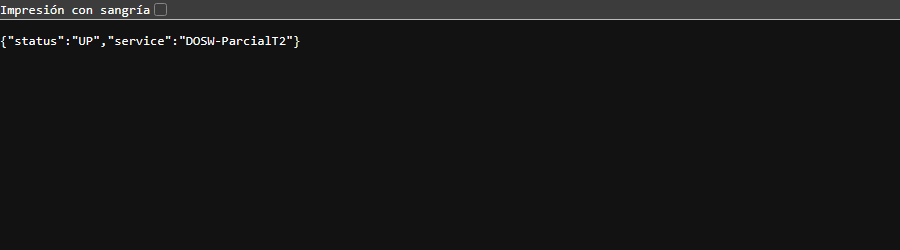

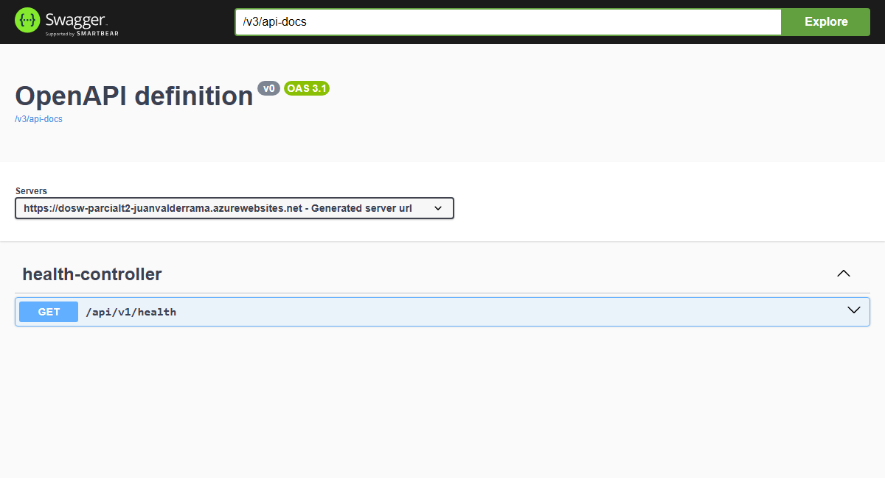

## 4. Estructura del proyecto
```
DOSW_ParcialT2_JuanValderrama/
├── docs/
│   ├── uml/                      # diagramas fuente
│   └── images/                   # exportes y evidencias del README
├── src/main/java/edu/dosw/parcial/
│   ├── controller/               # endpoints REST
│   │   ├── dtos/request|response # objetos de entrada/salida de la API
│   │   ├── mappers/              # Mapper IN: DTO ↔ Dominio
│   │   └── handlers/             # GlobalExceptionHandler
│   ├── core/
│   │   ├── services/             # lógica de negocio
│   │   ├── models/               # objetos de dominio
│   │   ├── validators/           # reglas de validación de negocio
│   │   └── utils/                # utilidades compartidas
│   ├── persistence/
│   │   ├── entities/             # clases @Document (MongoDB)
│   │   ├── repositories/         # MongoRepository
│   │   └── mappers/              # Mapper OUT: Dominio ↔ Document
│   ├── config/                   # SecurityConfig, SwaggerConfig
│   └── main/                     # clase @SpringBootApplication
├── src/main/resources/application.yaml
├── src/test/java/edu/dosw/parcial/{controller,core,persistence}
├── Dockerfile · .dockerignore
├── .github/workflows/ci-cd.yml
└── pom.xml
```

## 5. Tecnologías y dependencias
| Tecnología | Versión | Para qué se usa |
|---|---|---|
| Java | 21 | Lenguaje |
| Spring Boot | 3.5.6 | Framework base (Web, Validation, Security) |
| Spring Data MongoDB | (BOM Spring Boot) | Persistencia |
| JJWT | 0.12.6 | Generación/validación de tokens JWT |
| springdoc-openapi | 2.8.13 | Swagger UI |
| Lombok | (BOM Spring Boot) | Reducir boilerplate, `@Slf4j` para logs |
| MapStruct | 1.6.3 | Mappers DTO ↔ Dominio ↔ Document |
| JUnit 5 + Mockito | (spring-boot-starter-test) | Pruebas unitarias |
| Jacoco | 0.8.13 | Cobertura de pruebas |
| SonarQube (sonar-maven-plugin) | 5.1.0.4751 | Análisis estático |

## 6. Configuración y variables de entorno
| Variable | Descripción | Ejemplo |
|---|---|---|
| `MONGODB_URI` | Cadena de conexión a MongoDB | `mongodb://localhost:27017/dosw_parcial` |
| `JWT_SECRET` | Secret JWT en Base64 (mín. 44 caracteres) | `<secret_base64>` |
| `PORT` | Puerto HTTP (por defecto 8080) | `8080` |
| `WEBSITES_PORT` | Solo Azure: puerto al que enruta el App Service | `8080` |

## 7. Cómo ejecutar
**Mongo local con Docker**
```bash
docker run -d -p 27017:27017 --name mongo-parcial mongo:7
```
**Local con Maven**
```bash
JWT_SECRET=<secret_base64> mvn spring-boot:run
```
**Local con Docker** — ver [sección 9](#9-docker).

Luego abrir `http://localhost:8080/api/v1/health` y `http://localhost:8080/swagger-ui/index.html`.

## 8. Pruebas
```bash
mvn test
```
Reporte Jacoco: `target/site/jacoco/index.html`.

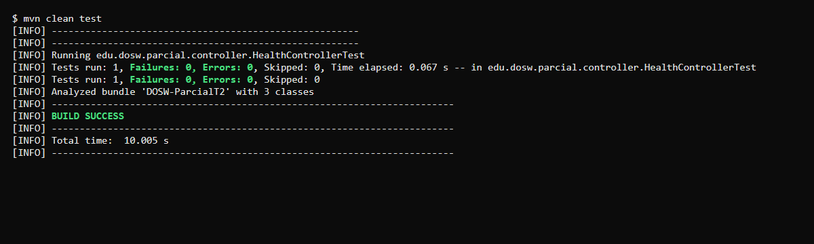
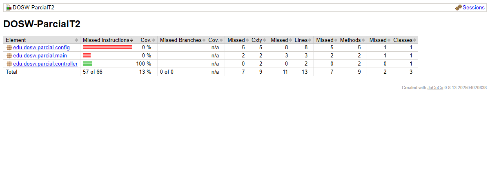

## 9. Docker
```bash
docker build -t dosw-parcial:local .
docker run -p 8080:8080 -e JWT_SECRET=<secret_base64> dosw-parcial:local
```
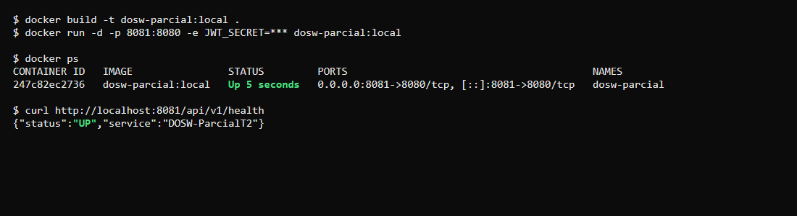

## 10. CI/CD
Workflow en `.github/workflows/ci-cd.yml`, se ejecuta con cada push a `main` y `develop`:
1. **test**: compila y ejecuta `mvn verify` (pruebas + Jacoco).
2. **docker**: construye la imagen y la publica en Docker Hub como `<usuario>/dosw-parcial-t2:latest`.
3. **deploy**: despliega la imagen en Azure App Service.

Secrets usados: `DOCKERHUB_USERNAME`, `DOCKERHUB_TOKEN`, `AZURE_CREDENTIALS`, `AZURE_WEBAPP_NAME`, `JWT_SECRET`.

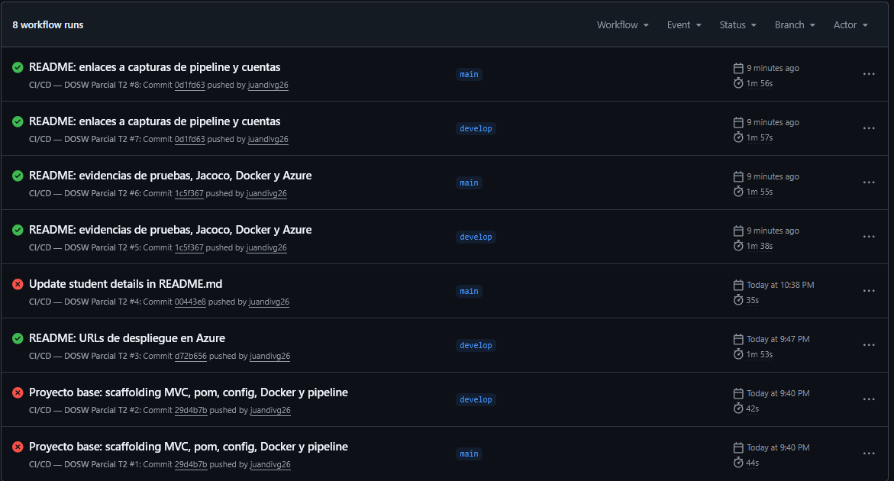

## 11. Herramientas de modelado y diseño (evidencias)
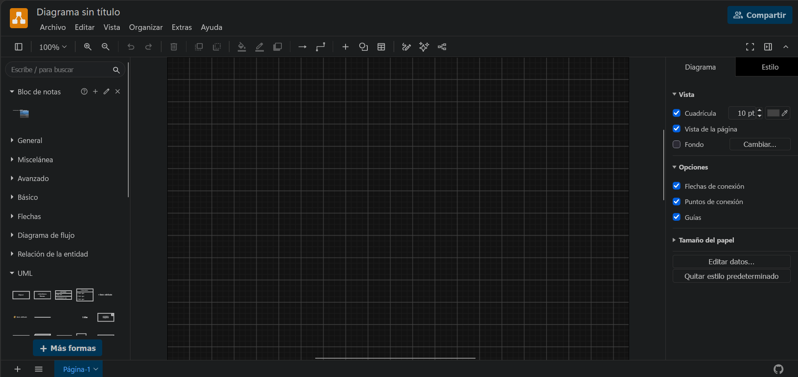
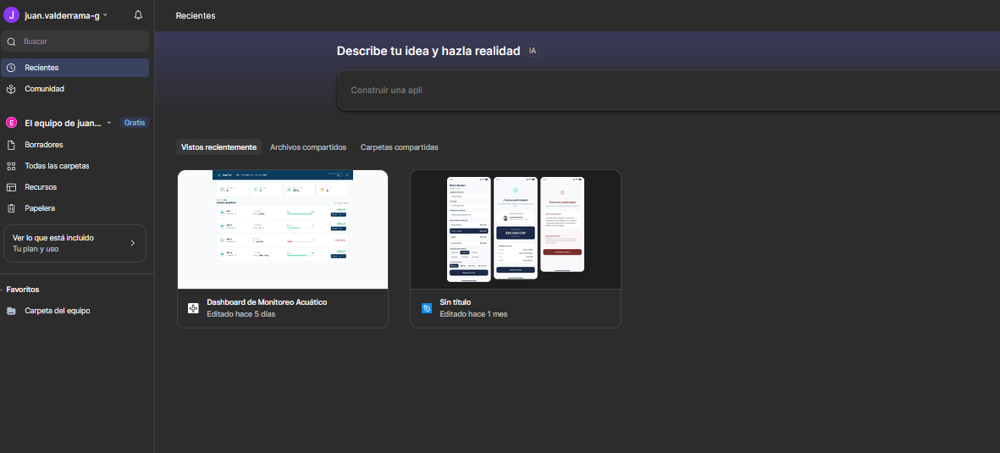

## SOLUCION DEL PARCIAL
### PUNTO 1
Excel en la ruta : docs/Punto1Parcial.xlsx

(a). ¿Diferencia entre validación de entrada y de negocio? Clasifique tres reglas. 

Una validación de entrada revisa que los datos enviados tengan la forma, el tipo y los límites exigidos por el contrato y valida los DTOs con @Valid. Una validación de negocio decide si la operación es permitida según el estado del sistema y las reglas del caso.

| Regla del caso | Clasificación | Justificación |
| --- | --- | --- |
| Edad de 0 a 360 meses | Entrada | Rango numérico conocido sin consultar otros documentos | 
| El nodo de origen debe existir y ser REFUGIO | Negocio | Depende de la jerarquía y datos persistidos en MongoDB. |
| Un adoptante solo puede tener una solicitud activa | Negocio | Requiere conocer solicitudes actuales del adoptante y prevenir carreras. |

 También son reglas de negocio que la mascota esté DISPONIBLE y que su compatibilidad coincida con la declaración de la persona. 

(b). Si fallan varias condiciones al adoptar, ¿qué error responde la API y qué evita modificar? 

Debe definirse una prioridad en las validaciones; no debe depender del orden accidental de consultas o fallos. Propuesta 1 autenticación y rol (401/403); 2 formato DTO (400); 3 existencia de mascota (404); 4 estado DISPONIBLE y solicitud activa (409); 5 compatibilidad y fecha (422). Si un mismo paso detecta múltiples errores de entrada, se pueden devolver todos los campos inválidos en un 400. 

Cualquiera que sea el primer error de negocio reportado, no debe crearse la solicitud, ni modificarse mascota.estado, ni registrarse aplazamiento o actividad parcial.

### PUNTO 2

#### Diagrama de componentes general
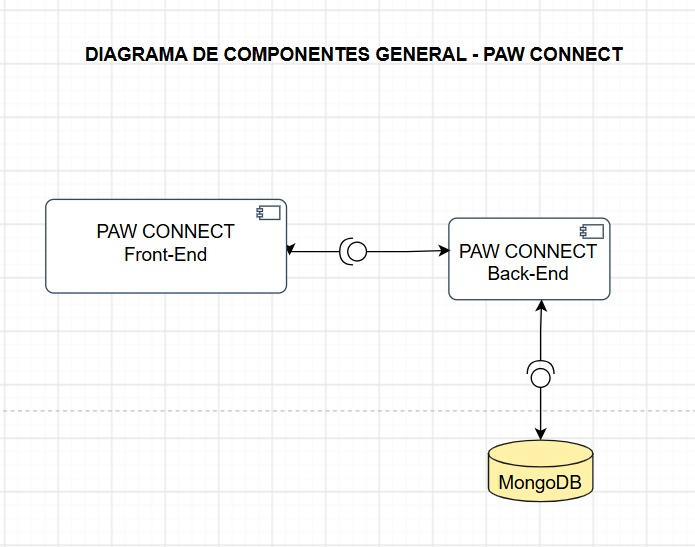
**Descripción:** muestra el sistema visto desde afuera: el Front-End de Paw Connect consume la API REST del Back-End (Spring Boot), y el Back-End persiste la información en MongoDB.

**Justificación:** se aplica el patrón cliente-servidor: el cliente pide y el servidor responde. La comunicación es stateless (cada petición lleva su JWT), lo que permite que el Front-End y la base de datos cambien sin afectar al otro lado mientras se respete el contrato de la API.

#### Diagrama de componentes específico (MVC)
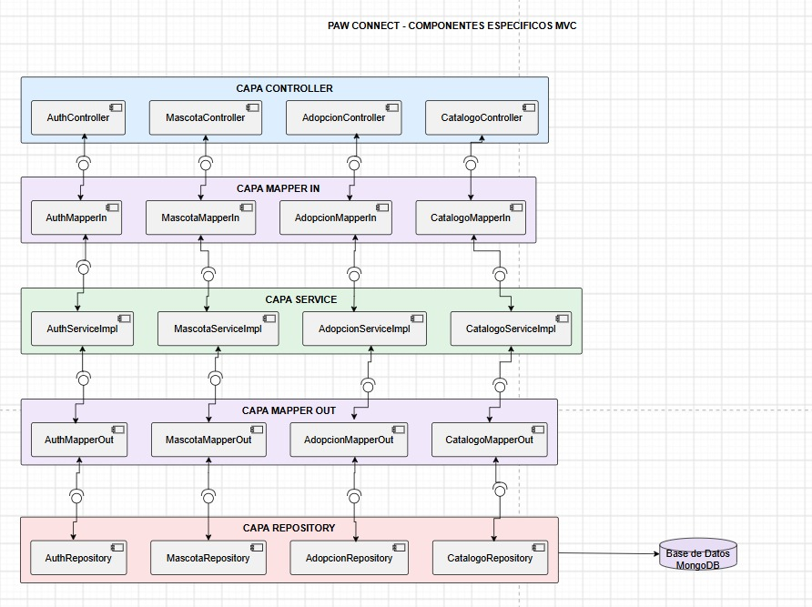
**Descripción:** muestra la organización interna del Back-End por capas: Controller, Mapper IN, Service, Mapper OUT y Repository, conectadas con MongoDB. Cada dominio (Auth, Mascota, Adopción) tiene su componente en cada capa.

**Justificación:** cada capa tiene una sola responsabilidad (SRP). El Controller solo maneja HTTP, el Service concentra las reglas de negocio y el Repository solo accede a MongoDB. Los componentes se conectan mediante interfaces e inyección de dependencias por constructor (inversión de dependencias), lo que da bajo acoplamiento y permite probar cada capa con mocks.

#### Diagrama de clases (dominio)
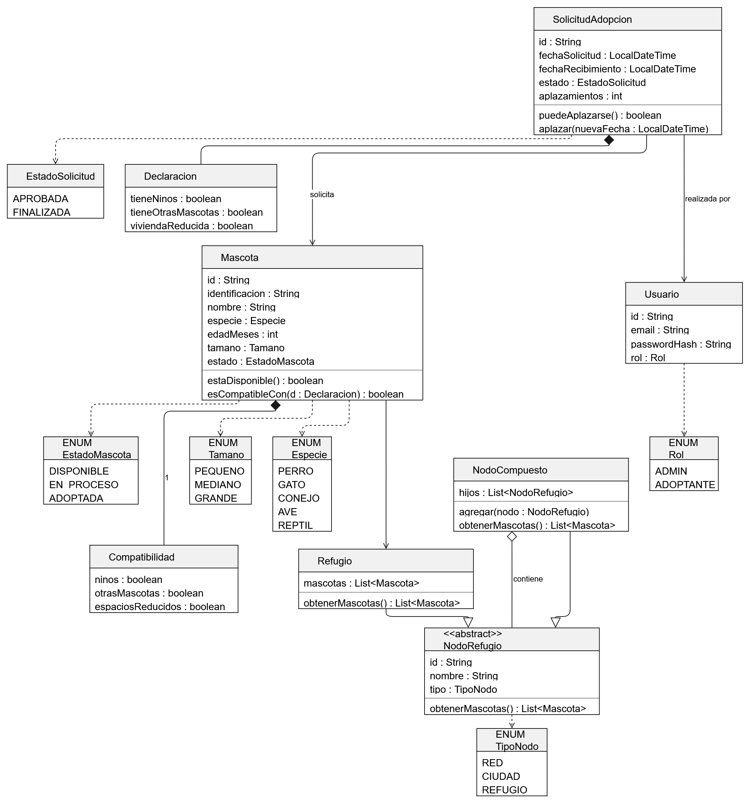
**Descripción:** muestra las clases del dominio con sus atributos, métodos y relaciones: la jerarquía de refugios, Mascota, SolicitudAdopcion, Usuario y sus enumeraciones.

#### Preguntas

**(a) ¿Qué problemas aparecen cuando no se separan correctamente las capas?**

Si las capas se mezclan, el código se acopla: un cambio en la base de datos o en el formato HTTP obliga a tocar la lógica de negocio, las reglas se duplican y las pruebas se vuelven difíciles porque no se puede aislar cada parte con mocks.

*Ejemplo del caso:* si AdopcionController validara la compatibilidad, cambiara el estado de la mascota y guardara directamente en MongoDB, esa lógica no se podría reutilizar ni probar sin levantar el servidor y la base de datos. En nuestro diseño las responsabilidades quedan así:
- AdopcionController recibe la petición, valida el DTO con @Valid y llama al servicio.
- AdopcionServiceImpl aplica las reglas: mascota DISPONIBLE, una sola solicitud activa, compatibilidad y fecha.
- AdopcionRepository solo guarda y consulta en MongoDB.

**(b) ¿Qué diferencia existe entre un validador, una utilidad y un servicio?**

| Tipo | Responsabilidad | Ejemplo en el diseño |
| --- | --- | --- |
| Validador | Verifica que los datos cumplan una regla antes de procesarlos. No guarda nada. | AdopcionValidator: revisa la compatibilidad entre la declaración y la mascota, y que la fecha esté entre 1 y 15 días. |
| Utilidad | Función genérica, estática y reutilizable, sin reglas de negocio ni estado. | FechaUtils: calcula los días entre hoy y la fecha de recibimiento. |
| Servicio | Orquesta el caso de uso: llama al validador, al repositorio y a los mappers, y aplica las reglas de negocio. | AdopcionServiceImpl: crea la solicitud APROBADA y pasa la mascota a EN_PROCESO. |

**(c) ¿Qué diferencia existe entre el Mapper IN y el Mapper OUT?**

| Mapper | Qué transforma | Ejemplo |
| --- | --- | --- |
| Mapper IN | Lo que **entra** al Service: RequestDTO → objeto de dominio, y Document de MongoDB → objeto de dominio | MascotaMapperIn convierte CrearMascotaRequestDTO en Mascota |
| Mapper OUT | Lo que **sale** del Service: objeto de dominio → ResponseDTO, y objeto de dominio → Document para persistir | MascotaMapperOut convierte Mascota en MascotaResponseDTO y en MascotaDocument |

Así el dominio no conoce el formato JSON de la API ni la estructura de MongoDB, y el Service siempre trabaja con objetos de dominio.

**(d) ¿En qué componente se ejecuta cada una de las tres reglas del punto 1?**

| Regla | Componente | Por qué |
| --- | --- | --- |
| Edad entre 0 y 360 meses (entrada) | DTO de request, validado con @Valid en MascotaController | Es una regla de formato y rango que no necesita consultar nada. Se rechaza antes de llegar al negocio, con 400. |
| El nodo debe existir y ser de tipo REFUGIO (negocio) | MascotaServiceImpl, que consulta el repositorio de nodos | Necesita leer la jerarquía guardada en MongoDB. Responde 404 si no existe y 422 si no es REFUGIO. |
| Un adoptante solo puede tener una solicitud activa (negocio) | AdopcionServiceImpl, que consulta AdopcionRepository | Depende de las solicitudes que ya existen para ese adoptante. Responde 409. |


### PUNTO 3

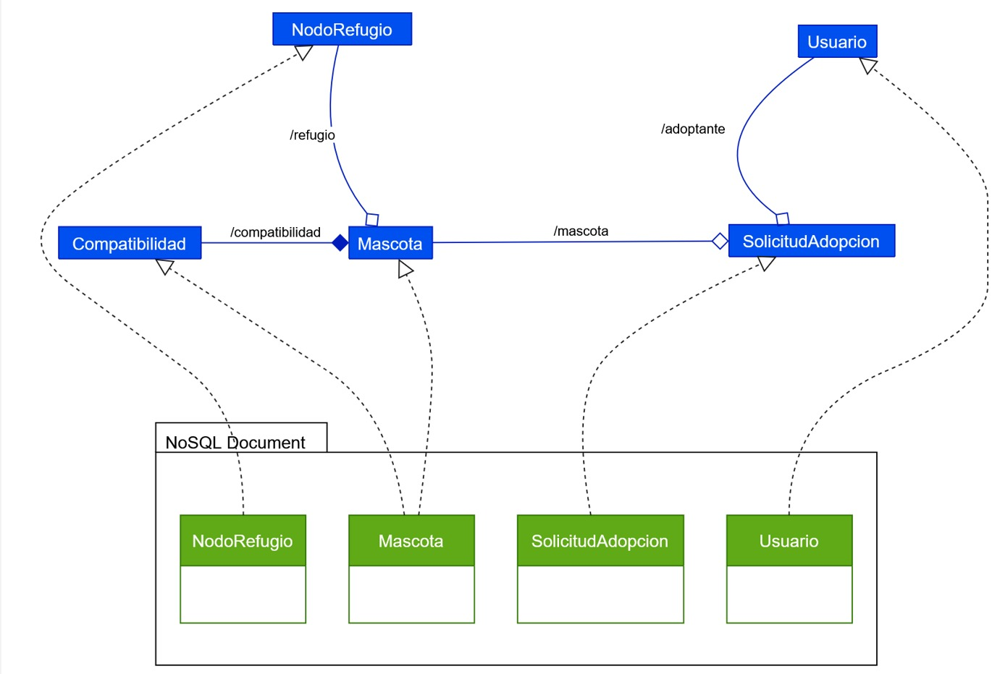

**Propuesta:** usar ambos. Embebidos para datos pequeños que se consultan con su padre y cambian con él; referenciados para entidades compartidas, consultadas independientemente o que crecen con el tiempo. 

| Documento | Modelo Recomendado | Justificacion                                                                   |
|---------|--------------------|---------------------------------------------------------------------------------|
| Macotas |Documento mascota con compatibilidad embebida y refugioId referenciado | Compatibilidad viaja con la mascota; refugio es compartido por muchas mascotas  |
| Nodos de jerarquía | Colección nodos con tipo y parentId | Permite recorrer RED→CIUDAD→REFUGIO y cambiar nodos sin reescribir todos los hijos |
| Solicitudes adopción | Documento separado con mascotaId y adoptanteId referenciados; aplazamientos contador embebido | Permite consultar por usuario, estado, fecha; crece sin inflar Mascota |
| Usuarios | Colección separada con email, passwordHash y rol | Acceso y permisos propios; contraseñas nunca embebidas en mascota/solicitud |

**Ventaja:** Los documentos pequeños como compatibilidad se recuperan con la mascota sin consultas adicionales; las referencias reducen duplicación y evitan que un documento crezca ilimitadamente por solicitudes históricas. 

**Desventaja:** Las referencias requieren consultas extra o agregaciones ($lookup); actualizar una adopción puede involucrar varios documentos y exigir medidas de consistencia. Embeber historial ilimitado inflaría los documentos y dificultaría las actualizaciones.


### PUNTO 4

**A)**

**UBICACION Y EJEMPLOS:**

`AUTENTICACION:` Login valida email/BCrypt y emite JWT firmado. Un filtro comprueba token en peticiones protegidas. 

`AUTORIZACION:` ADMIN puede crear mascota; ADOPTANTE puede adoptar. Aplazar exige además ser titular de la solicitud. 

`INTEGRIDAD:` @Valid, invariantes del service, índices, actualizaciones atómicas; firma JWT detecta alteración del token. 

La autenticación inválida genera normalmente 401; un usuario autenticado sin permiso genera 403. La integridad no equivale a confidencialidad: esta última se protege además mediante HTTPS, control de acceso y manejo seguro de secretos. 

**B)**

**Riesgo 1 — A01: Broken Access Control (control de acceso roto)**

`Escenario:` un ADOPTANTE llama PATCH /api/v1/adopciones/{id}/recibimiento con el ID de la solicitud de otro adoptante; o llama POST /api/v1/mascotas para crear una mascota, función reservada a ADMIN.

**Mitigación.** Verificar roles con Spring Security y comprobar en el servicio la titularidad usando el usuario autenticado del JWT. No confiar en adoptanteId enviado desde el body. Aplicar denegación por defecto.

**Cómo probarlo.** Enviar petición sin token → 401; token ADOPTANTE a crear mascota → 403; token de adoptante A sobre solicitud de B → 403 y sin cambio en Mongo. Token ADMIN a creación válida → 201.

**Riesgo 2 — A07: Identification and Authentication Failures**

`Escenario:` contraseñas almacenadas en texto plano, login sin control ante intentos masivos, JWT aceptado sin validar su firma o expiración, o mensajes que revelan si un correo existe.

**Mitigación.** Guardar contraseñas con BCrypt/PasswordEncoder; JWT firmado y de vida limitada; JWT_SECRET privado, HTTPS, errores genéricos, validación del usuario activo, límites de intentos y monitoreo de accesos fallidos.

**Cómo probarlo.** Contraseña incorrecta → 401 sin distinguir usuario existente/no existente; token expirado o firma modificada → 401; inspección de Mongo para comprobar hash y no password en texto; nunca mostrar secreto ni token completo en logs. 

**C)**

`Propuesta:` autenticación con correo/contraseña y JWT Bearer mediante Spring Security, API stateless. Los usuarios ya están precargados en MongoDB, el login público valida la contraseña comparando el hash BCrypt y devuelve un token firmado; el cliente lo envía en Authorization: Bearer <token>. En cada operación la API valida token, expiración, usuario, rol y titularidad según corresponda.

`Justificación:` permite separar autenticación de las operaciones REST y probar fácilmente el acceso en Swagger Authorize, sin sesiones de servidor. No sustituye la seguridad de transporte HTTPS. Para un MVP académico resulta apropiado si se controla la expiración, el secreto, la autorización y la protección de credenciales.

`Enunciado contradictorio:` la matriz dice “Iniciar sesión: sin token → 401”, pero el login necesita aceptar credenciales sin token previo. Debe corregirse esa fila en el contrato y justificarlo. 

### PUNTO 5

#### Escenarios de prueba de "Adoptar una mascota" (TDD)

Las pruebas se escriben **antes** que el código, siguiendo el ciclo **Red → Green → Refactor**:

1. **Red:** se escribe la prueba de un escenario (por ejemplo, P03 "mascota no disponible") y se ejecuta. Falla porque la regla aún no existe.
2. **Green:** se escribe el código mínimo en AdopcionServiceImpl para que la prueba pase.
3. **Refactor:** se limpia el código sin cambiar su comportamiento (por ejemplo, se mueven las reglas a AdopcionValidator) y se vuelven a correr todas las pruebas para confirmar que siguen en verde.

Cada prueba sigue la estructura **Arrange / Act / Assert**, y los repositorios se reemplazan por mocks (Mockito) para que no dependan de MongoDB.

| ID | Escenario | Datos (Arrange) | Resultado esperado (Assert) |
| --- | --- | --- | --- |
| P01 | Adopción exitosa (E10) | Mascota DISPONIBLE, adoptante sin solicitud activa, declaración compatible, fecha a 5 días | 201. La solicitud se crea APROBADA y la mascota pasa a EN_PROCESO. Se guarda una vez cada una. |
| P02 | Fecha en el límite inferior | Fecha a 1 día de hoy | 201. Se crea la solicitud. |
| P03 | Fecha en el límite superior | Fecha a 15 días de hoy | 201. Se crea la solicitud. |
| P04 | Mascota no existe | mascotaId inexistente | 404 MASCOTA_NO_ENCONTRADA. No se guarda nada. |
| P05 | Mascota no disponible (E06) | Mascota en estado EN_PROCESO | 409 E06. La mascota conserva su estado y no se crea la solicitud. |
| P06 | Segunda solicitud (E8) | El adoptante ya tiene una solicitud APROBADA | 409 E8. No se crea otra solicitud ni se modifica la segunda mascota. |
| P07 | Incompatible con niños (E04) | Declara niños y la mascota no es compatible con niños | 422 E04. La mascota sigue DISPONIBLE. |
| P08 | Incompatible con otras mascotas (E04) | Declara otras mascotas y la mascota no es compatible | 422 E04. La mascota sigue DISPONIBLE. |
| P09 | Incompatible con vivienda reducida (E04) | Declara vivienda reducida y la mascota no es apta para espacios reducidos | 422 E04. La mascota sigue DISPONIBLE. |
| P10 | Fecha hoy (E07) | Fecha a 0 días | 422 E07. No se crea la solicitud ni se modifica la mascota. |
| P11 | Fecha muy lejana (E07) | Fecha a 16 días | 422 E07. No se crea la solicitud ni se modifica la mascota. |
| P12 | Varias fallas a la vez | Mascota EN_PROCESO **y** declaración incompatible | 409 E06. Gana la primera regla del orden y la de compatibilidad nunca se evalúa. |
| P13 | Datos de entrada inválidos | Falta la declaración o la fecha | 400 DATOS_INVALIDOS. El servicio nunca se llama. |
| P14 | Sin token / rol incorrecto | Sin JWT, o con JWT de ADMIN | 401 / 403. El controlador rechaza antes de llegar al servicio. |

P01 a P12 son **pruebas unitarias del servicio**. P13 y P14 son **pruebas del controlador** con MockMvc, porque la validación del DTO y la seguridad viven en esa capa.

#### Cómo se comprueba el orden y que no se modifique nada ante una falla

- **El orden de las validaciones:** con InOrder de Mockito se verifica que primero se consulta la mascota, después las solicitudes activas del adoptante y al final se guarda. En P12 se verifica que la regla de compatibilidad **no se ejecuta** cuando la mascota ya no está disponible, lo que demuestra que se respeta el orden 404 → 409 → 422.
- **Que no se cree la solicitud:** en todos los escenarios de error se verifica verify(solicitudRepository, never()).save(any()).
- **Que no se modifique la mascota:** se verifica verify(mascotaRepository, never()).save(any()) y además se comprueba con assertEquals que el objeto mascota sigue en su estado original (DISPONIBLE o EN_PROCESO).
- **Que se lance el error correcto:** con assertThrows se verifica el tipo de excepción y su código (E06, E8, E04, E07).
- **Fechas estables:** se inyecta un Clock fijo en el servicio para que "hoy" sea siempre la misma fecha y las pruebas de 1, 15 y 16 días no fallen según el día en que se ejecuten.

#### Preguntas para la revisión con el equipo de Calidad

**a ¿Cómo aportan las pruebas evidencia del cumplimiento de las reglas de negocio? ¿Qué se verificaría con pruebas unitarias?**

Cada regla del caso de uso tiene al menos una prueba que la ejerce, tanto en el camino exitoso como en el de rechazo. Si la prueba pasa, queda evidencia automática y repetible de que la regla se cumple. Si alguien la rompe después, la prueba falla y el pipeline lo detecta antes de desplegar. El reporte de JaCoCo complementa esa evidencia mostrando qué líneas y ramas del código se ejecutaron.

Con **pruebas unitarias** se verifica la lógica aislada de cada clase, sin base de datos ni servidor:
- en el **servicio**: las reglas de negocio (disponibilidad, solicitud activa, compatibilidad, rango de fechas, cambio de estado) y que no se guarde nada ante un error;
- en el **validador**: cada combinación de compatibilidad y los límites de las fechas;
- en el **dominio**: métodos como estaDisponible(), esCompatibleCon() y puedeAplazarse().

Lo que depende de varias capas juntas (la validación del DTO, la seguridad con JWT y la respuesta HTTP real) se verifica con pruebas del controlador o de integración.

**b ¿Las pruebas por sí solas garantizan la ausencia de errores?**

No. Las pruebas demuestran la **presencia** de errores, no su ausencia: solo comprueban los escenarios que alguien pensó en escribir. Un 100% de cobertura indica que todas las líneas se ejecutaron, no que todos los casos posibles estén bien. Puede quedar un escenario sin prueba, una prueba mal planteada, o fallas que solo aparecen con la base de datos real, con concurrencia (dos adopciones simultáneas de la misma mascota) o en el ambiente desplegado.

Por eso las pruebas se complementan con:
- el análisis estático (SonarQube);
- la revisión de código en los Pull Requests;
- las pruebas funcionales en Swagger;
- los logs para detectar fallas en producción.

### PUNTO 6

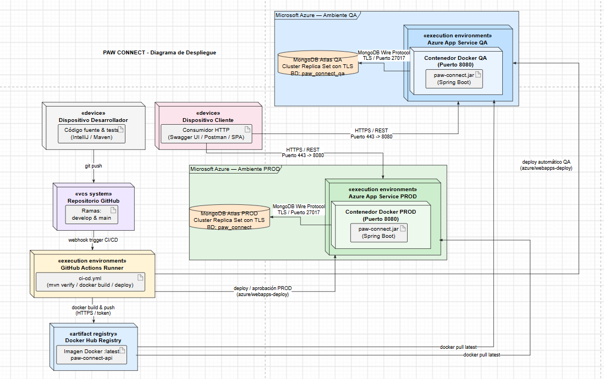

**A)**

| Etapa | Propósito y acciones típicas |
| --- | --- |
| Trigger / checkout | Push o integración en develop; descargar versión exacta del commit. |
| Setup | Instalar Java 21 y preparar caché/dependencias Maven. |
| Build y pruebas | Compilar, ejecutar JUnit/Mockito y producir JaCoCo (>80 % según enunciado). |
| Calidad y seguridad | Análisis estático, validación de dependencias y rechazo de hallazgos graves. |
| Empaquetar imagen | Construir JAR y Dockerfile reproducible; etiquetar imagen con SHA. |
| Publicar artefacto | Autenticación segura y push a Docker Hub. |
| Deploy Azure | Desplegar la imagen exacta en App Service usando secretos. |
| Smoke / verificación | Probar endpoint de health/Swagger y caso básico; guardar evidencia y logs. |

**B)**

No. El pipeline debe interrumpirse y marcar la ejecución como fallida. En Actions el job de build/deploy depende de test (needs: test); si este falla, no se publica ni despliega esa versión. Esto evita distribuir un cambio que ya incumple un comportamiento automatizado. Solo un proceso de excepción documentado y aprobado podría alterar la política, no un ignore de fallos sin control.

**C)**

Permiten diagnosticar incidentes, seguir la operación entre capas y conocer qué regla rechazó una petición. En una adopción fallida registrar timestamp, correlationId/requestId, ruta, código HTTP, código de error, mascotaId, adoptanteId seudonimizado, regla de rechazo y tiempo de respuesta. En autenticación registrar fecha, resultado exitoso/fallido, identificador técnico de usuario si aplica, IP con medidas de privacidad, razón técnica controlada, intentos y correlationId. No registrar la contraseña ni el JWT.

**D)**

| Registrar | Nunca registrar |
| --- | --- |
| requestId, traceId, timestamp, método HTTP, ruta, status, latencia | Contraseñas, passwordHash BCrypt, JWT, refresh token, claves de firma. |
| mascotaId, solicitudId, adoptanteId interno cuando sea necesario | URI Mongo con usuario/contraseña, connection strings completas, secretos de Azure/GitHub. |
| errorCode, nombre de regla, transición de estados, identificador de servicio | Body completo del login, direcciones, teléfonos y datos personales innecesarios. |
| Versión de despliegue/commit, excepción en registros internos protegidos | Stack trace completo devuelto al cliente o tokens en URLs. |

**E)**

El log interno debe aportar información técnica suficiente para investigar sin exponer secretos y estar protegido por controles de acceso/retención. El cliente debe recibir un código HTTP y un mensaje estable, claro y breve, sin detalles de infraestructura ni stack trace. Ejemplo: log seguro “requestId=abc123, adopcion_rechazada, codigo=PET_INCOMPATIBLE, mascotaId=masc-013, status=422”; respuesta HTTP “422, code=PET_INCOMPATIBLE, message=La mascota no es compatible con la declaración”.

TIEMPO INICIAL FINALIZADO
